## About me

I'm a software engineering student based in **Rabat, Morocco**, and I love understanding how
complex systems work, then building my own. I started from the ground up in C and C++, and
today I build full products end to end: database design, authentication, APIs, frontend,
tests and CI.

- **Backend:** FastAPI, NestJS and Java
- **Frontend:** React and TypeScript
- **Currently:** building a hackathon platform with a team of five (Scrum, code review, CI on every merge)
- **Languages:** Arabic, French, English

## Tech stack

<table align="center">
  <tr>
    <td align="right"><b>Languages</b></td>
    <td></td>
  </tr>
  <tr>
    <td align="right"><b>Frameworks</b></td>
    <td></td>
  </tr>
  <tr>
    <td align="right"><b>Databases</b></td>
    <td></td>
  </tr>
  <tr>
    <td align="right"><b>Tools</b></td>
    <td></td>
  </tr>
</table>

## Featured projects

<table>
  <tr>
    <td width="50%" valign="top">
      <h3><a href="https://github.com/SaadM33/url-shortener">URL Shortener</a></h3>
      
Short links with accounts, expiry dates, click analytics, QR codes and an admin area.
      Google sign-in, email verification, Redis-backed rate limiting and a Dockerised
      production stack behind Caddy.

      

        
        
         
        
        
        
        
        
      

    </td>
    <td width="50%" valign="top">
      <h3><a href="https://github.com/Dexter88xD/HackSpace">HackSpace</a></h3>
      
A platform for organising and joining hackathons: events with phases, registration,
      team formation, profiles and skills, with Google and 42 Intra OAuth. Built by a team
      of five with Jira, pull-request reviews and GitHub Actions.

      

        
         
        
        
        
        
      

    </td>
  </tr>
  <tr>
    <td width="50%" valign="top">
      <h3><a href="https://github.com/SaadM33/Internet-Relay-Chat">IRC Server</a></h3>
      
An IRC server written from scratch: many clients on a single thread with a non-blocking
      <code>poll()</code> event loop, password-protected registration, channels with operators,
      topics, invites, keys and member limits, private messages, and a small ASCII-art bot.

      

        
         
        
        
      

    </td>
    <td width="50%" valign="top">
      <h3><a href="https://github.com/SaadM33/my-portfolio">Portfolio</a></h3>
      
My personal site, designed as an engineering drawing set ("blueprint" style), with
      hand-drawn SVG architecture diagrams and interactive in-browser project demos,
      including one compiled to WebAssembly.

      

        
         
        
        
      

    </td>
  </tr>
</table>

## GitHub activity

